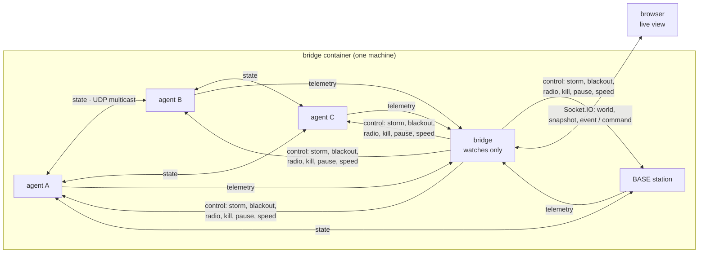
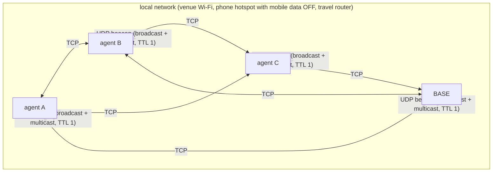

# Ridgeline: architecture

Ridgeline is a team of search agents looking for a missing hiker on a 40×40 mountain grid (50 m cells). **No agent is in charge.** Every searcher is its own OS process with its own clock, its own copy of the map and its own idea of where the hiker probably is. Agents share what they know only when their simulated radios can actually reach each other, and a ridge across the middle of the map blocks line of sight.

This document covers what runs where, how a message moves, how one agent thinks, and where in the code the "no central decision-maker" rule is enforced.

## What runs where



| Piece | Code | Runs as |
|---|---|---|
| Agent (searcher or BASE) | [server/src/live/agent-process.ts](server/src/live/agent-process.ts), driving [web/lib/sim/agent.ts](web/lib/sim/agent.ts) | One OS process each, spawned by the bridge |
| Bridge | [server/src/live/bridge.ts](server/src/live/bridge.ts) | One process: HTTP + Socket.IO on `:4000` |
| Wire format | [server/src/live/wire.ts](server/src/live/wire.ts) | UDP multicast `239.255.42.99`, ports 41235/6/7, deflated JSON |
| Decentralised mesh | [server/src/mesh.ts](server/src/mesh.ts) | UDP beacon discovery (broadcast + multicast) + TCP mesh, flood/gossip with dedup |
| Standalone agent node | [server/src/agent-node.ts](server/src/agent-node.ts) | One OS process each, joined to the mesh — no bridge, no internet |
| Comparison runner | [server/src/live/runner.ts](server/src/live/runner.ts) | A child process started by `POST /api/compare` |
| Live view | [web/app/page.tsx](web/app/page.tsx) | Next.js page; canvas map plus panels |
| In-browser mock | [web/lib/mock.ts](web/lib/mock.ts), driving [web/lib/sim/engine.ts](web/lib/sim/engine.ts) | Same agent class, with messages delivered in memory |

**The same agent code runs in three places:**
- as a live process
- in the browser, as the fallback mock
- in the headless runner that produces the comparison numbers

Only the transport changes, so the comparison is fair and the mock behaves the same as the live system.

## The three channels

| Channel | Direction | Radio-filtered? | Carries |
|---|---|---|---|
| **state** | agent ⇄ agent | **Yes, by the receiver** | Position, every sweep table it knows about, the find, teammates' intended targets |
| **telemetry** | agent → bridge | No | Everything the browser shows. No agent ever reads it |
| **control** | bridge → agents | No | Environment faults only, typed as `ControlMsg` in [web/lib/contract.ts](web/lib/contract.ts) |

**Radio checks happen at the receiver.** Every state packet carries the sender's position, and the receiving agent decides whether it "heard" it ([agent-process.ts:63](server/src/live/agent-process.ts#L63) → [radio.ts:21](web/lib/sim/radio.ts#L21)). The packet is lost if any of these apply:
- the sender is more than 12 cells away (**range**)
- the terrain between them is higher than the line between two 2 m antennas, judged on the receiver's own copy of the map (**terrain**)
- a random draw under the current packet-loss rate (**storm**)

macOS caps UDP datagrams at 9,216 bytes. A state message with seven sweep tables is about 16 KB as JSON, but the tables are mostly zeros, so deflating brings it down to 2–4 KB. [wire.ts](server/src/live/wire.ts) throws if a packet would ever exceed the cap.

## One tick of an agent

[`SimAgent`](web/lib/sim/agent.ts) is transport-agnostic. Each tick runs `receive()` and then `act()`:

1. **Receive** ([agent.ts:178](web/lib/sim/agent.ts#L178)). For each packet the agent heard, it merges what the sender knows:
   - **Sweep tables:** each agent's table only ever grows. A copy with a higher version number is strictly newer, so merging is just "keep the newer copy".
   - **Find:** if two finds disagree, keep the earliest.
   - **Intents:** each teammate's planned target, keeping the newest.

   A peer silent for more than 16 ticks is marked stale.
2. **Choose a mode** ([agent.ts:318](web/lib/sim/agent.ts#L318)):

   | Mode | When |
   |---|---|
   | `search` | Default |
   | `messenger` | Found the hiker, but base hasn't confirmed and isn't in range: walk back to tell it |
   | `converge` | Base confirmed the find: head to the casualty |
   | `relay` | Cut off for a long time: climb to high ground to restore a link |
   | `hold` | Central strategy only: no orders |

3. **Decide** ([agent.ts:356](web/lib/sim/agent.ts#L356)). Search scores every cell:

   ```
   score(c) = belief(c) / (1 + 0.15·cost) − 0.8·maxBelief·claimed(c)
   ```

   - `belief` is where the hiker probably is: the prior, discounted by every sweep this agent knows about.
   - `cost` is distance plus climbing.
   - `claimed` marks cells near a teammate's last known target. It fades out over 90 ticks after the agent last heard about that plan.

   This is why agents **avoid ground they expect teammates to cover even while cut off**. When a teammate dies, its claim fades and others take over its area. The chosen target and the reason ("avoiding B near (16,10)") are shown in the UI.
4. **Move** one 8-connected step, waiting a tick on steep ground. **Sweep** the cell. The hiker is detected with 80% probability per sweep.
5. **Send** its state, unless its radio is off, and send telemetry.

## Strategies (only target choice differs)

| Strategy | Who chooses targets | What happens when comms fail |
|---|---|---|
| **ridgeline** (ours) | Each agent, using shared maps and teammates' claims | Keeps searching on its own map; avoids teammates' last known areas; merges on reconnect |
| independent | Each agent, ignoring everyone | Unaffected, but agents waste effort re-sweeping each other's ground |
| central | BASE assigns every target ([agent.ts:454](web/lib/sim/agent.ts#L454)) | Searchers finish their last order, then **hold** until new orders reach them |

## Where "no central decision-maker" is enforced

- **The control channel can't carry a goal.** `ControlMsg` in [contract.ts](web/lib/contract.ts) is a closed union: `storm | blackout | radio | kill | pause | resume | speed`. It has no target field. The bridge's only way to talk to agents is `sendControl(c: ControlMsg)` ([bridge.ts:66](server/src/live/bridge.ts#L66)).
- **The bridge never reads agent state back into agents.** Telemetry flows one way, from agents to the bridge to the browser. Agents never listen on the telemetry port.
- **Agents can't see the casualty.** The bridge passes only `sha256(cell:salt)`. An agent learns it has found the hiker only by standing on the cell and passing the detection draw ([agent-process.ts](server/src/live/agent-process.ts)).
- **The only planner is the deliberate baseline:** BASE in `central` mode, and its orders travel over the same lossy radio as everything else.

## Browser data path

[web/lib/socket.ts](web/lib/socket.ts) exposes `useSim()`:
- **Source selection:** it connects to the bridge, falls back to the mock after 2 s, keeps probing, and offers "Switch to live" when the bridge appears.
- **Reset race:** it drops snapshots and events from an earlier `runId`.
- **Delta sweeps:** it merges delta sweep tables. The bridge sends a table only when it changed.
- **Event normalisation:** it collapses blackout link churn into one log line.
- **Presenter key:** `?key=` unlocks controls; anyone without it gets a read-only view.

The canvas reads snapshots from a ref at 60 fps. React panels update at most 5 times a second.

**Views:**
- **Truth:** the union of everything every agent has swept.
- **Base:** what the controller knows.
- **Agent X:** X's own belief. The "missing N sweeps" badge is the gap between X's view and Truth, which is how you *see* an agent cut off.

## Results

From `bun run compare`: 20 seeds × 4 packet-loss levels × 3 strategies = 240 runs. All three strategies use the same mountain, the same 5 searchers and the same radio model.

| At 60% packet loss | ridgeline | independent | central |
|---|---|---|---|
| Median steps to find | **55.5** | 128.5 | 623.5 |
| Runs where the hiker was found | **100%** | 100% | 75% |
| Duplicate sweeps | **33%** | 67% | 33% |

The probability-searched curves come from a second pass with detection switched off. Otherwise a run that ends at the find would cut its own curve short.

## Decentralised backend (no internet)

The bridge demo keeps every agent in one container because multicast doesn't cross Docker overlay networks. When the internet is unavailable and agents must run on separate devices, the same `SimAgent` runs over a different transport:



| Stage | Mechanism |
|---|---|
| **Discovery** | Every node broadcasts/multicasts a small `{ id, tcpPort }` beacon on one UDP port. Peers on the same network hear it. The lexicographically larger id dials the smaller, so each pair opens exactly one TCP link. Static `--peers id@host:port` entries work even where broadcast/multicast is blocked. |
| **Data** | Persistent TCP links carry newline-delimited JSON. A message `{ from, seq, ttl, type, body }` is flooded: each node forwards it to its other peers, and an `(origin, seq)` seen-set stops loops, so every node receives it exactly once regardless of hop count. |
| **Radio model** | Unchanged. The mesh delivers *everything*; the receiver still runs `canHear` (range, line of sight, storm) and drops what its radio couldn't reach. Multi-hop delivery is the transport, the radio check is the physics. |

[`server/src/mesh.ts`](server/src/mesh.ts) implements the transport; [`server/src/agent-node.ts`](server/src/agent-node.ts) is one agent = one process joined to it, reusing the same wire format (`stateToJson`/`stateFromJson`) and the same `SimAgent`. [`server/src/main.ts`](server/src/main.ts) launches a full team on one machine for local demos; across real devices, run `bun src/agent-node.ts …` on each with one shared `--seed/--salt/--hash` (printed by `--gen-config`). The mesh never carries a goal, only `state`, so "no central decision-maker" still holds.

## Known limits

- **The radio is a model, not RF:** a range limit, line of sight over a terrain grid with 12 m of diffraction allowance, and an independent packet-loss draw.
- **The live bridge demo runs in one container on one machine.** Multicast doesn't cross Docker overlay networks, so the browser demo keeps the team together. Splitting agents across devices uses the decentralised mesh above instead; the agent logic does not change.
- **One shared simulation per bridge.** Viewers without the presenter key get read-only access.
- The multicast bridge is `server/src/live/`; the decentralised no-internet transport is `server/src/mesh.ts` + `server/src/agent-node.ts`, launched locally by `server/src/main.ts`.
