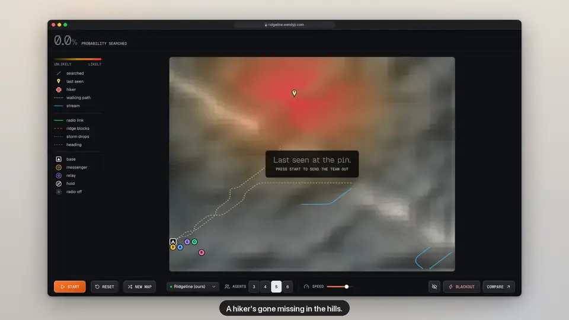

# Ridgeline

**A team of search agents looks for a missing hiker. No one is in charge, and ridges block their radios.**

Built at GreatUniHack 2026 for the Neptune North challenge: *design an approach to a problem which involves systems working together in a distributed fashion, even when communications are interrupted.*

Each searcher is its own OS process with its own map and its own decisions. Agents share what they've searched only when their simulated radios can reach each other. When cut off, they keep searching and stay off ground they expect teammates to be covering. When they reconnect, their maps merge without conflicts. If one is killed, the others take over its area.

## Demo

[](docs/demo.mp4)

*Silent preview of the key moments. Click it for the full 43-second video with voiceover ([`docs/demo.mp4`](docs/demo.mp4)). Recorded with the in-browser simulation.*

## Results

240 simulated runs (20 mountains × 4 radio packet-loss levels × 3 strategies):

| At 60% packet loss | **Ridgeline** | Independent searchers | Central planner |
|---|---|---|---|
| Median steps to find the hiker | **56** | 129 | 624 |
| Runs where the hiker was found | **100%** | 100% | 75% |
| Effort wasted re-searching ground | **33%** | 67% | 33% |

At 90% packet loss, Ridgeline still finds the hiker in every run. The central planner finds it in 60%.

## Run it

You need [Bun](https://bun.sh) 1.3 or later.

```bash
# Live: real agent processes over UDP multicast, plus the bridge on :4000
cd server && bun install && bun run dev:sim

# Web: the live view on :3000. It falls back to an in-browser simulation if the bridge is down.
cd web && bun install && bun run dev
```

Open http://localhost:3000, press **Space** to start, then try **B** (radio blackout), **1–6** (view one agent's map), and **Kill** on an agent card. **N** (or **New map**) generates a different mountain; **R** (Reset) replays the current one. The default map, seed 39, is the one the demo script is tuned for. `/compare` shows the strategy comparison.

| Variable | Where | Purpose |
|---|---|---|
| `NEXT_PUBLIC_BRIDGE_URL` | web (build time) | Bridge address (default `http://localhost:4000`) |
| `NEXT_PUBLIC_MOCK=1` | web | Always use the in-browser simulation |
| `RIDGELINE_KEY` | bridge | Presenter key. Open `/?key=…` once to unlock controls; everyone else gets a read-only view |
| `CORS_ORIGINS` | bridge | Allowed web origins (default `http://localhost:3000`) |

**Deploy:** `docker-compose.yml` runs both services. It's meant for a Dokploy "Docker Compose" app, with domains set in Dokploy.

## How it works

See **[ARCHITECTURE.md](ARCHITECTURE.md)** for:
- the processes and channels, with a diagram
- one tick of an agent
- how maps merge without conflicts
- the three strategies
- where in the code "no central decision-maker" is enforced

| Folder | What's inside |
|---|---|
| `server/src/live/` | Bridge, agent process, multicast wire format, comparison runner |
| `web/lib/sim/` | The agent itself (shared by live, mock and benchmark): world generation, radio model, decision logic |
| `web/app/`, `web/components/` | Live view (canvas map, per-agent views, controls) and compare page |
